# 孔明棋 Peg Solitaire

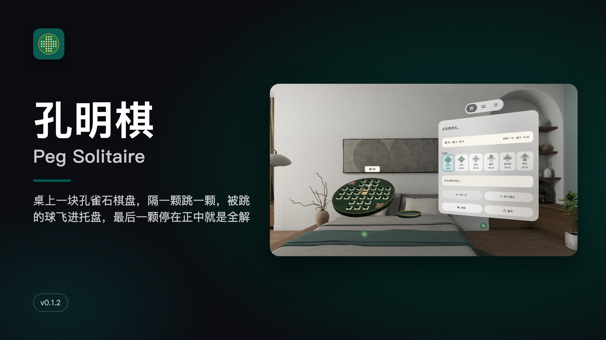

[中文](#中文) · [English](#english)

---

## 中文

**桌上一块孔雀石棋盘，隔一颗跳一颗，被跳的球飞进托盘，最后一颗停在正中就是全解。**

PICO 空间应用（PICO OS 6 · Spatial SDK BOM 6.1.9 · Shared Space 体积窗口 + 控制窗）。一块 0.42 m 的孔雀石棋盘摆在你面前：33 个象牙色棋槽、32 颗孔雀石球，只空正中一孔。规则是经典的英式孔明棋（单人跳棋）：一颗球隔着旁边那颗跳进空槽，被跳过的那颗拔起、飞进托盘；横竖都行，斜的不行；跳到没得跳为止，剩得越少越好，最后一颗正好停在正中就是全解。

### 能做什么

- **点球、点孔**：点一颗球，它套上青环，被跳的那颗套粉环，能落的空槽上方浮起琥珀色落点环；点落点，球沿弧线跳过去
- **看得见的结果**：被跳的那颗抬起、飞进棋盘右边的托盘；全解时最后一颗升起发光，卡住时剩下的球变红
- **提示（求解器）**：打开提示后，每一跳都告诉你「这一跳还能全解」「没把握」或「全解已不可能」；已经不可能时给出 [悔 n 步]，一键回到最近一个还能全解的盘面
- **六个经典起始图**：标准 / 钻石 / 加号 / 壁炉 / 金字塔 / 箭头，每张图各自记录全解次数和最少步数
- **悔一步不限次数**，每一跳自动存档，关掉再开接着下
- **真实的声音**：落子、落托盘都是 CC0 实物录音；选球和悬停没有声音
- **棋盘倾角**：0 / 30 / 45 / 60 / 90° 五档（默认 30°），托盘始终平放
- 控制窗三页：对局 / 规则（含来历）/ 设置；音量三档、静音、减少动态、首局引导、[退出应用]
- 手势捏合、眼手和手柄射线都能点；中英双语；本机运行，不联网、不要账号

### 截图

> v0.1.2 截图来自 PICO 模拟器（画质高清 2560，中文界面），由调试广播驱动，**非真实手势录像**。演示视频 `video-01.mp4` 在 Release 资产里（标准开局 18 步全解，同样非真实手势录像，无声）。

| | |
|---|---|
| 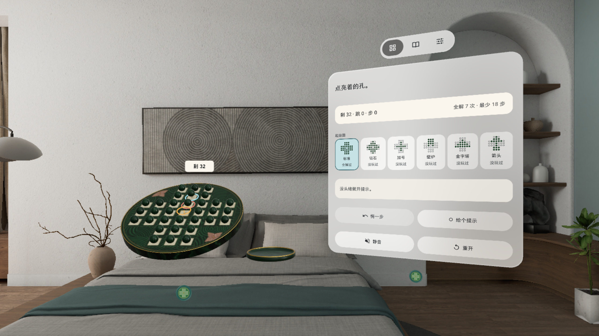 选中一颗球：青环选中、粉环是要被跳的那颗、琥珀环是落点；控制窗说「点亮着的孔」 |  近看孔雀石棋盘：33 个象牙槽、32 颗球和右边平放的托盘 |
| 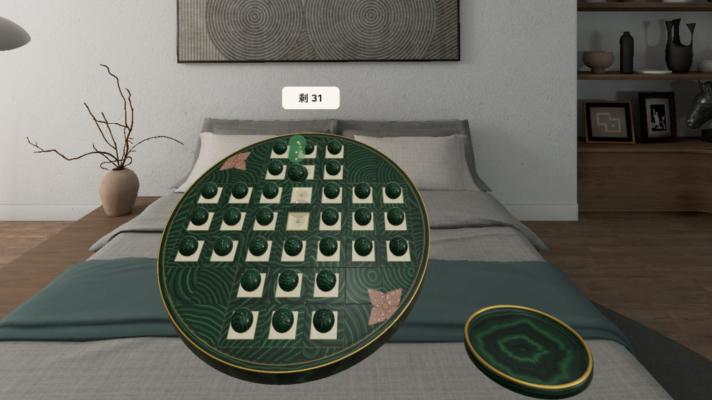 跳子中：球沿弧线跳向正中，计数牌变成「剩 31」 | 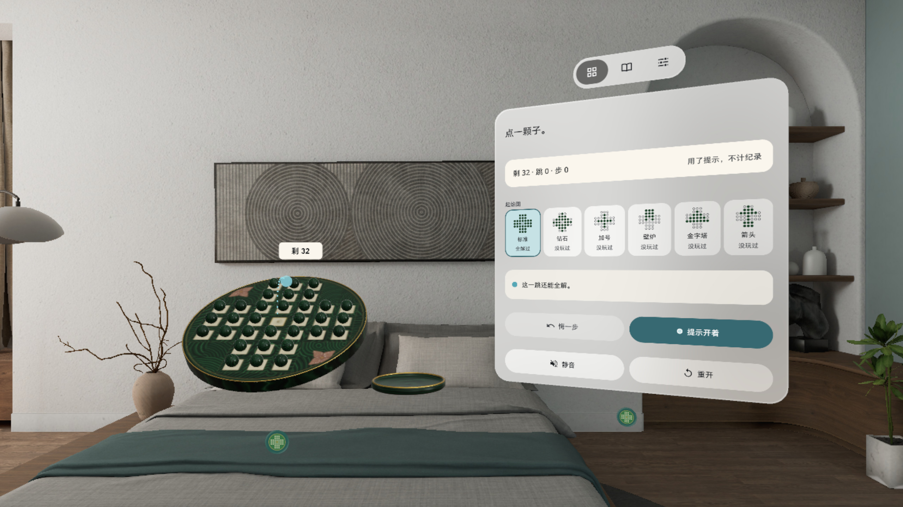 提示开着：控制窗写「这一跳还能全解」，盘上青色标记标出下一跳 |
| 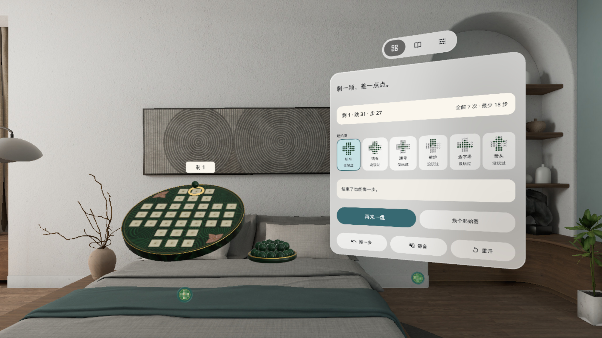 剩一颗但不在正中：托盘里 31 颗球，控制窗给出 [再来一盘] [换个起始图] | 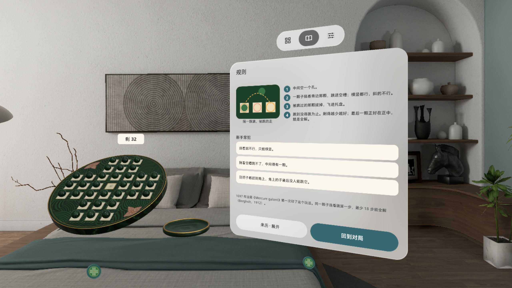 规则页：一张图 + 四句规则 + 新手常犯三条 + 来历 |

### 安装

[Release v0.1.2](https://github.com/kejing-dev/PegSolitaire/releases/tag/v0.1.2) 里的 `PegSolitaire-v0.1.2.apk` 是 `assembleRelease` 出的未签名包（给应用商店上架用，`adb install` 会拒绝）。自己装请从源码构建 debug 包，头显开启开发者模式并用 USB 连上电脑：

```bash
./gradlew assembleDebug
adb install -r app/build/outputs/apk/debug/app-debug.apk
pico-cli app launch io.embodit.pegsolitaire
```

需要 PICO OS 6（Android 15，minSdk 35）。不需要额外权限。

### 已知问题

1. 模拟器在冷启动同时建场景、负载高时，恢复「提示开着 + 已无解」的存档后，[悔 n 步] 要 9–12 s 才出现（「全解已不可能」仍在 1 s 内出）；真机耗时没有单独测。
2. 开局时棋盘和控制窗的位置由系统（Shared Space）决定，偶尔整组偏右、控制窗半出视野；用系统把手拖回即可。
3. 孔雀石球和孔雀石盘面明暗接近（ΔL* 约 2.6），靠象牙槽、高光和接触阴影托出轮廓（用户按现状放行）。
4. 0° 倾角平放时落点环浮 2.2 cm，平视时和选中球的青环在画面上靠得近（默认 30° 没有这个问题）。
5. 音效不是空间音；响度按离线渲染校过。
6. 拖动跳子、37 孔 / 三角盘、自由摆盘、重做 / 回放、第二套皮肤在下个版本。

### 版本历史

- **v0.1.2**：首个公开版本（用户真机试玩后放行）。模拟器 QA 三轮修的：中途开提示时「全解已不可能」立即判定、[悔 n 步] 回到的盘面确定且最近；恢复存档后 [悔 n 步] 不再一直转圈；[悔一步] 灰态字加深
- **v0.1.1**：QA 第 1 轮返工（提示判定计时、悔 n 步确定性、灰态字、确认行高、重开抖动、0° 落点高度、读档摆位）
- **v0.1.0**：首个构建，孔雀石棋具、六个起始图、提示求解器、CC0 音效、五档倾角

### 许可与素材

- 字体：Noto Sans（SIL OFL 1.1，见 `third_party/noto-sans/`）
- 音效：freesound.org CC0 录音（Hongsungbock、KaleidacousticsAudio）和 Kenney（kenney.nl）impact-sounds，CC0 1.0；来源见 `tools/sound-sources.txt`
- 图标：Material Icons / PICO ICON pack
- 棋盘、球和托盘模型由 `tools/build_models.py` 纯 Python 生成
- 本仓库公开；用 Claude Code 在「黑灯工厂」产线上研发（Claude Opus 5.5 研发 / QA / 发布，Claude Fable 5.1 调研 / 设计）
- 开发结构、调试命令见 [AGENTS.md](AGENTS.md)

---

## English

**A malachite board on your table: hop a ball over its neighbour, the hopped ball flies into the tray, and one ball left dead centre is a full solve.**

A PICO spatial app (PICO OS 6 · Spatial SDK BOM 6.1.9 · Shared Space volume + control window). A 0.42 m malachite board sits in front of you: 33 ivory cups, 32 malachite balls, only the centre hole empty. The rules are classic English peg solitaire: a ball hops over its neighbour into an empty hole and the hopped ball comes out and goes to the tray; straight lines only, no diagonals; keep going until you are stuck. Fewer left is better, and a last ball dead centre is a full solve.

### Features

- **Tap a ball, tap a hole**: tap a ball and it gets a cyan ring, the ball it would hop gets a pink ring, and an amber target ring floats over each hole it can land in; tap a target and the ball arcs over
- **Results you can see**: the hopped ball lifts and flies into the tray right of the board; on a full solve the last ball rises and glows, when you are stuck the remaining balls turn red
- **Hint (solver)**: with hints on, every hop is marked "keeps a full solve", "not sure" or "a full solve is no longer possible"; when it is no longer possible, [Undo n] takes you back to the nearest board that can still be solved
- **Six classic start boards**: Standard / Diamond / Plus / Fireplace / Pyramid / Arrow, each with its own solve count and best move count
- **Unlimited undo**, autosave on every hop; close and reopen to carry on
- **Real sounds**: landing and tray drops are CC0 recordings; selecting and hovering are silent
- **Board tilt**: 0 / 30 / 45 / 60 / 90° (default 30°); the tray always stays flat
- Three-page control window: Play / Rules (with history) / Settings; three volume levels, mute, reduced motion, first-game coach, [Exit app]
- Hand pinch, eye-hand and controller ray all work; Chinese and English; fully offline, no account

### Screenshots

> v0.1.2 PICO emulator screenshots (high-definition 2560, English UI), driven by debug broadcasts — **not a recording of real hand input**. The demo video `video-01.mp4` is a Release asset (standard board solved in 18 moves, Chinese UI, also not real hand input, no sound).

| | |
|---|---|
| 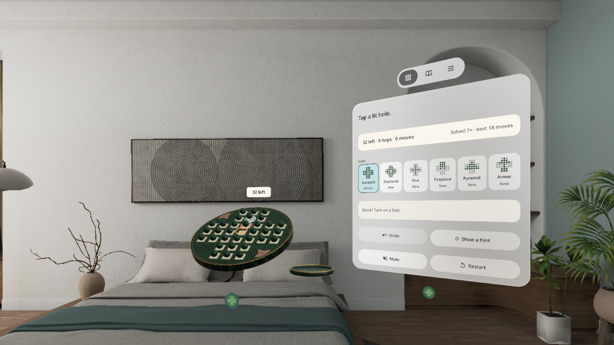 A ball selected: cyan = selected, pink = the ball to hop, amber = landing target; the panel says "Tap a lit hole" |  Close-up of the malachite board: 33 ivory cups, 32 balls and the flat tray on the right |
| 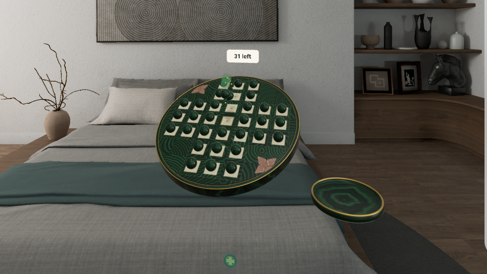 Mid-hop: the ball arcs to the centre, the counter now reads "31 left" | 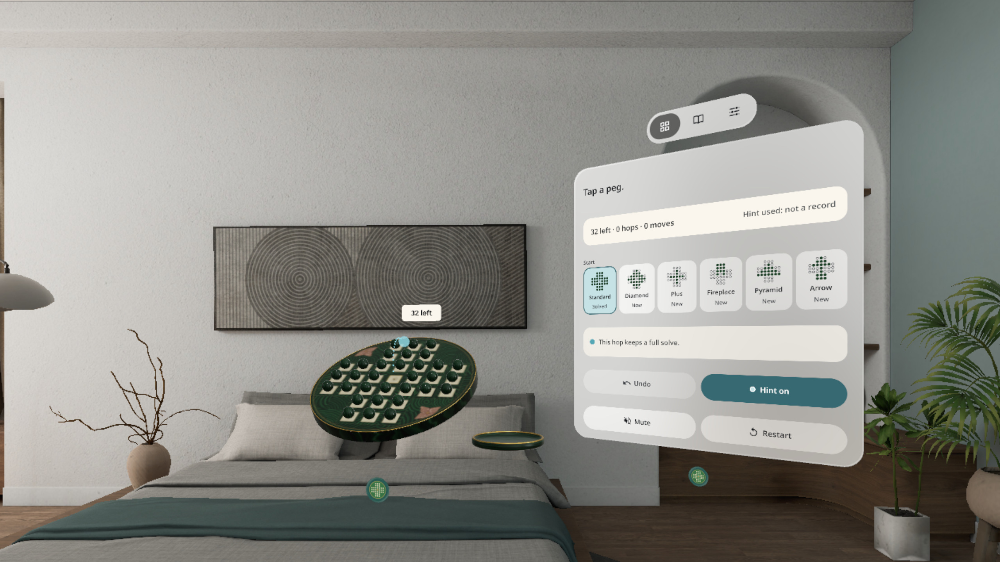 Hint on: "This hop keeps a full solve", a cyan marker shows the next hop |
| 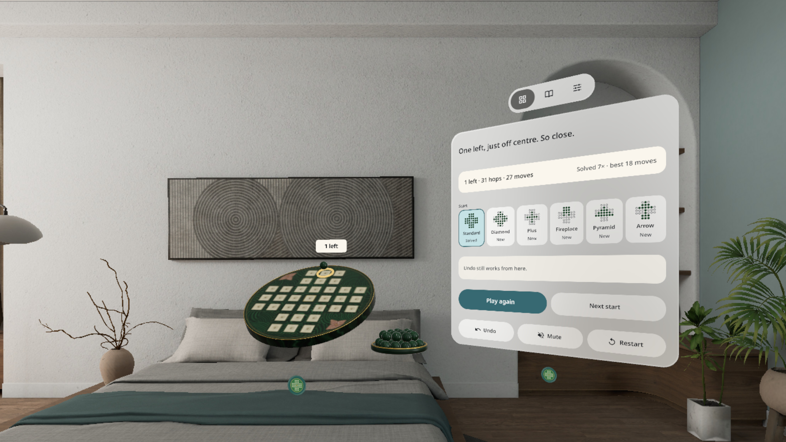 One left, just off centre: 31 balls in the tray, [Play again] [Next start] on the panel | 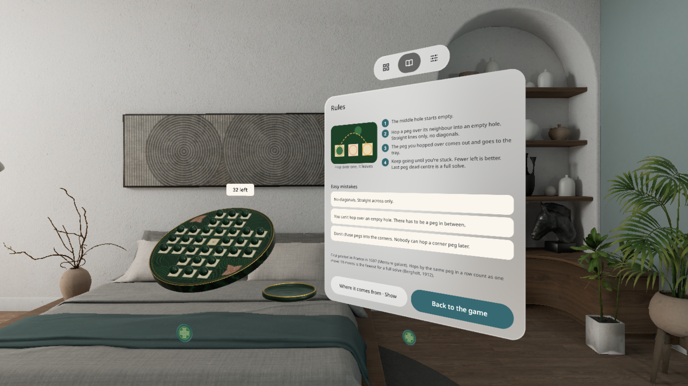 Rules: one diagram, four rules, three easy mistakes and where the game comes from |

### Install

`PegSolitaire-v0.1.2.apk` in [Release v0.1.2](https://github.com/kejing-dev/PegSolitaire/releases/tag/v0.1.2) is an unsigned `assembleRelease` build (for store submission; `adb install` rejects it). To install it yourself, build the debug APK from source, enable developer mode on the headset and connect it over USB:

```bash
./gradlew assembleDebug
adb install -r app/build/outputs/apk/debug/app-debug.apk
pico-cli app launch io.embodit.pegsolitaire
```

Requires PICO OS 6 (Android 15, minSdk 35). No extra permissions.

### Known issues

1. On a heavily loaded emulator (cold start while the scene is still building), after restoring a save with hints on and no solve left, [Undo n] takes 9–12 s to appear ("no longer possible" still shows within 1 s); not timed separately on a headset.
2. Where the board and the control window open is decided by the system (Shared Space); sometimes the group sits to the right with the control window half out of view. Drag it back with the system handle.
3. The malachite balls and the malachite board are close in lightness (ΔL* about 2.6); the ivory cups, highlights and contact shadows carry the outline (accepted as is by the user).
4. At 0° tilt the target rings float 2.2 cm over the holes and sit close to the selected ball's cyan ring at eye level (not an issue at the default 30°).
5. Sounds are not spatial; loudness was checked on an offline render.
6. Drag-to-hop, 37-hole / triangle boards, free setup, redo / replay and a second skin come in a later version.

### Version history

- **v0.1.2**: first public version (approved after the user played it on a headset). Fixed over three emulator QA rounds: "no longer possible" shows at once when hints are turned on mid-game, [Undo n] goes back to a fixed, nearest solvable board; after restoring a save [Undo n] no longer spins forever; darker greyed-out [Undo] text
- **v0.1.1**: QA round 1 fixes (hint timing, deterministic undo-n, greyed text, confirm line height, restart jitter, 0° target height, load placement)
- **v0.1.0**: first build: malachite set, six start boards, hint solver, CC0 sounds, five tilt angles

### Licences and assets

- Font: Noto Sans (SIL OFL 1.1, see `third_party/noto-sans/`)
- Sounds: CC0 recordings from freesound.org (Hongsungbock, KaleidacousticsAudio) and Kenney (kenney.nl) impact-sounds, CC0 1.0; sources in `tools/sound-sources.txt`
- Icons: Material Icons / PICO ICON pack
- Board, ball and tray models are generated in pure Python by `tools/build_models.py`
- This repository is public; built with Claude Code on the "lights-out factory" line (Claude Opus 5.5 for build / QA / release, Claude Fable 5.1 for research / design)
- Code map and debug commands: [AGENTS.md](AGENTS.md)
